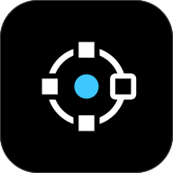
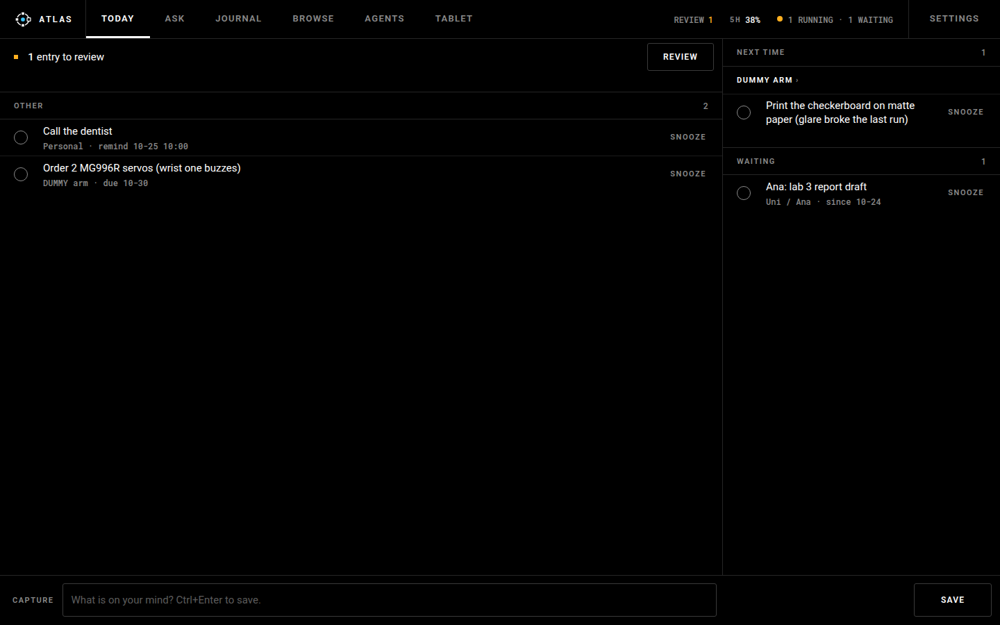
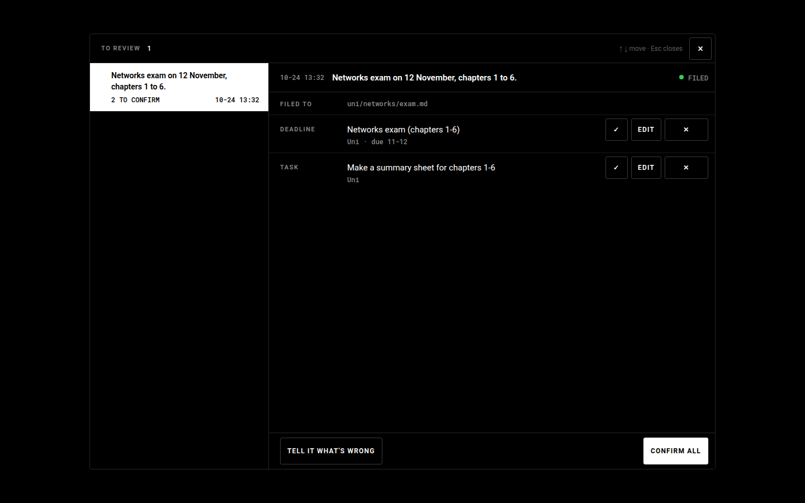
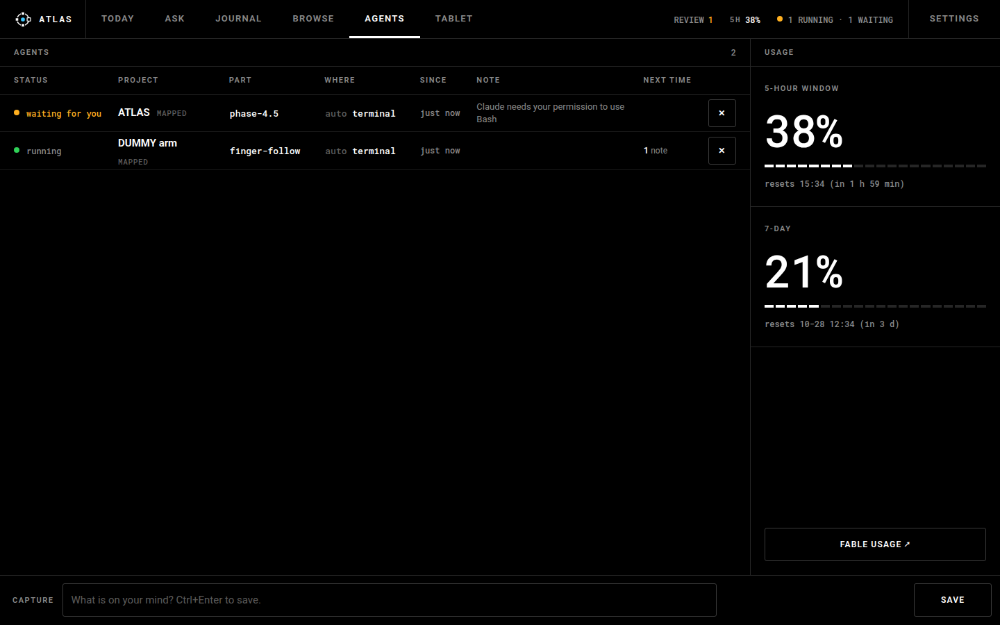
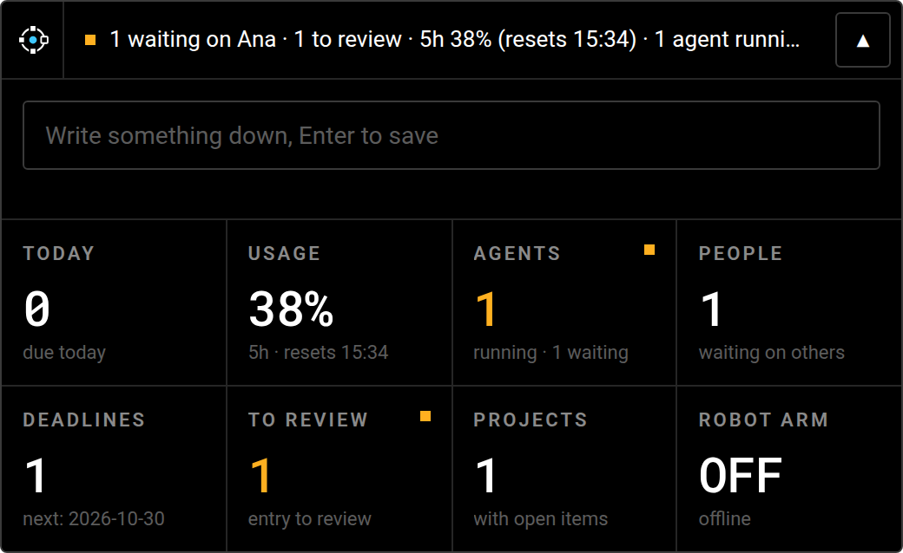
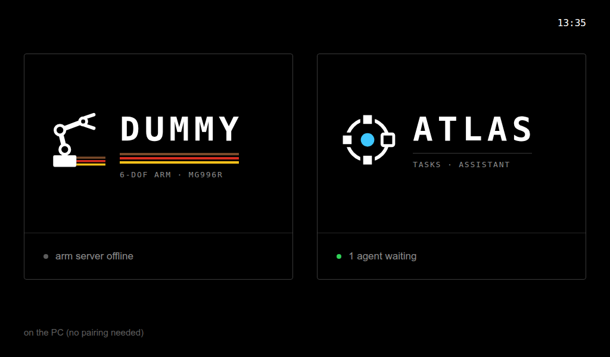
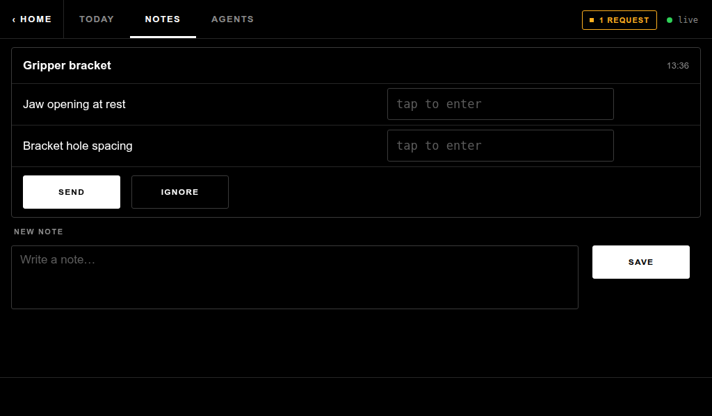

<h1 align="center">ATLAS</h1>

<b>A second brain that files your notes for you, and keeps an eye on your Claude Code agents.</b> 
Local, private, one owner. Runs on a dual-boot laptop (Kubuntu and Windows) and a workbench tablet.

## What it is

You write things down the way you'd say them: *"order two more servos before Friday, the wrist one is
buzzing"*, *"Ana is sending the lab report"*, *"remind me to call the dentist tomorrow at 10"*. ATLAS
keeps every word exactly as you typed it. Then a Claude Code agent, running on your own subscription,
files the note into a folder of Markdown notes and suggests what it could become: a deadline, a
reminder, something you're waiting on, a tip for next time.

**Nothing becomes a task until you say so.** Every suggestion waits for a ✓. Later you can ask
"when is the networks exam?" and get your own words back, with a link to where you wrote them, or a
plain `Nothing on that.` It never makes things up.

It also watches your Claude Code sessions: which ones are working, which one is waiting for you, and
how much of your usage limit is left.

## A tour

### Review: you confirm what the agent suggests
New notes open in a review card with the agent's suggestions. Tick them, edit them, drop them, or
tell it what it got wrong and it re-files.

### Today
Everything you confirmed and that matters now: deadlines, reminders, things you're waiting on,
and tips filed under the project they belong to. The capture bar is always at the bottom
(Ctrl+Enter saves).

### Agents and usage
Every Claude Code session on this PC, with its project, branch and state. A session that needs your
permission turns amber, and ATLAS says so out loud. Next to it are your 5-hour and weekly usage.

### The widget
A small always-on-top bar on the desktop. You can see what needs you at a glance and capture a note
without opening anything. Its tiles jump straight to the right page in the app.

### The workbench tablet
An old Galaxy Tab at the bench runs a page made for it (Android 4.2, big touch targets, its own
keyboard). Its home screen chooses between the two halves of the bench: **DUMMY**, the robot arm,
and **ATLAS**.

On the ATLAS side you see today's list, your agents, and **measurement requests**. An agent at the PC
can ask "how wide is the gripper jaw?", and you answer on the tablet with the tape measure in your
other hand. Notes typed there land in the same log.

### A voice
ATLAS speaks a few things, in a British voice that runs fully offline: an agent that needs you, an
agent that finished a long job, a reminder that's due, a readback of what you typed on the tablet.
A quip often follows, from a list you can edit. Quiet hours and a pause button keep it polite. It varies how it says things, keeps what's due today in your ear, notices
things about itself, and can talk a little on its own: how much is one setting, from Mute to Very high.
No microphone, ever.

## Where it stands (October 2026)

| | |
|---|---|
| **Built and in daily use** | Capture, filing, review, Today, recall (phase 1) · usage meter, Agents panel, widget, desktop shell (phase 2) · dual boot on one shared drive (Kubuntu now, Windows later) · the workbench tablet (phase 3) · voice and sass (phase 4) · the native app window and the instrument-panel look (phase 4.5) · the name ATLAS and its logo |
| **Updates** | Start ATLAS from the app menu and it updates itself: it pulls `master` once CI has passed, rebuilds the app when its code changed, then opens. Merge a PR, restart ATLAS, done. |
| **On hold** | Phase 5 (Google Calendar) and phase 6 (phone), until the phases so far prove themselves. Windows checks wait until Windows is back in use. |
| **Next** | Tuning how the agent files things, from real "I wrote X, it did Y" cases. |

## How it works, briefly

- **The hub** is a small Python server on `127.0.0.1` (only the tablet gets in over Wi-Fi, after pairing). Your notes are a folder of Markdown files in their own git repo, with an optional push to a private GitHub backup.
- **The agent** is the `claude` CLI, run headless and boxed in: an explicit tool list, no settings or memory of its own, never touching your main notes directly (it works in a throwaway git worktree, and the result is checked before it's taken in).
- **The raw log is sacred:** every capture is written verbatim before anything else happens, and nothing ever rewrites it. If the shared drive is missing, captures wait in a holding inbox instead of being lost.
- **The desktop app** is a thin Tauri window around the hub's pages, with a tray icon. It starts the hub, restarts it if it falls over, and runs the update step before each start.

## Docs

- **Setup, running, tests:** [app/README.md](app/README.md) · [the desktop app](app/desktop/README.md) · [what's on the owner's list](TODO.md)
- **Design:** [the spec](docs/superpowers/specs/2026-10-20-atlas-design.md) (the authority for every phase) · [phase 2](docs/superpowers/specs/2026-10-21-atlas-phase2-design.md) · [dual boot](docs/superpowers/specs/2026-10-21-atlas-dual-boot-design.md) · [phase 3, the tablet](docs/superpowers/specs/2026-10-23-atlas-phase3-design.md) · [phase 4, the voice](docs/superpowers/specs/2026-10-23-atlas-phase4-design.md) · [phase 4.5, the app and the look](docs/superpowers/specs/2026-10-24-atlas-phase4_5-design.md) · [the rename](docs/superpowers/specs/2026-10-24-atlas-rename-design.md)
- **Build decisions:** [phase 1](docs/superpowers/phase1-decisions.md) · [phase 2](docs/superpowers/phase2-decisions.md) · [dual boot](docs/superpowers/dual-boot-decisions.md) · [phase 3](docs/superpowers/phase3-decisions.md) · [phase 4](docs/superpowers/phase4-decisions.md) · [phase 4.5](docs/superpowers/phase4_5-decisions.md) · [rename](docs/superpowers/atlas-rename-decisions.md)
- **The logo:** [docs/brand](docs/brand/README.md) · **the name:** ATLAS (was BrainHub until 2026-10-24) · [the rename](docs/superpowers/specs/2026-10-24-atlas-rename-design.md)

The screenshots come from a scratch hub filled with made-up notes, with the agent's filing faked so the pages have something to show.
